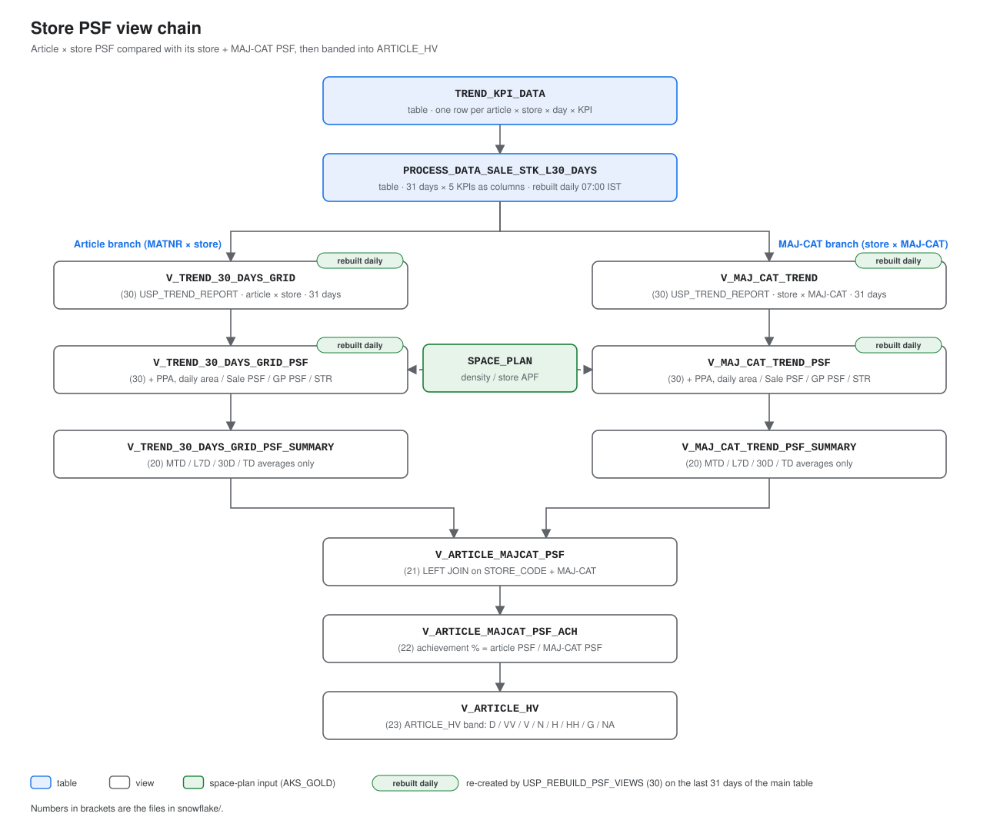
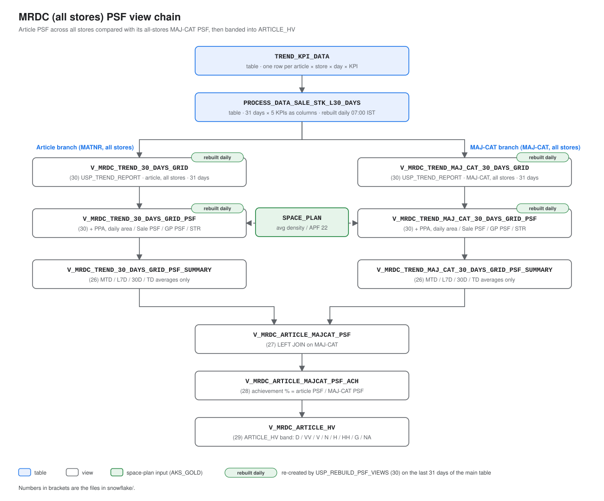

# L30D Sale & Stock: SQL Server → Snowflake

Moving the daily "last 30 days stock + sale" process and its reports from SQL Server (`DataV2`) to Snowflake.
Everything lives in **`V2RETAIL.SILVER`**, is owned by **`PROGRAMMER_DEV_ROLE`**, and refreshes **every day at 07:00 IST**.

## In short

```
07:00  Step 1  collect stock + sales of the last 31 days   → V2RETAIL.SILVER.TREND_KPI_DATA (long list)
  ↓    Step 2  one row per article per store, APP/GM/MKT   → V2RETAIL.SILVER.PROCESS_DATA_SALE_STK_L30_DAYS (main table)
  └──► Step 2b MAJ_CAT summary                              → V2RETAIL.SILVER.PROCESS_DATA_SALE_STK_L30_DAYS_MAJCAT
       Step 3  on-demand report procedure (not scheduled)   → V2RETAIL.SILVER.USP_MRST_SAL_STK_L30_TREND
       Step 5  on-demand trend reports by name, with sort   → V2RETAIL.SILVER.USP_TREND_REPORT
```

Each step starts as soon as the previous one succeeds. If a step fails, the ones after it don't run and
yesterday's data stays in place. After the morning run, everything shows the **31 days up to yesterday**.

## Objects created (full names)

All in database `V2RETAIL`, schema `SILVER`, owned by `PROGRAMMER_DEV_ROLE`. Short names used further
down in this README always mean `V2RETAIL.SILVER.<name>`.

| Object | Type | Created by | Purpose |
|---|---|---|---|
| `V2RETAIL.SILVER.TREND_KPI_DATA` | transient table | [00_](snowflake/00_create_trend_kpi_data.sql) | step 1 output (long list) |
| `V2RETAIL.SILVER.PROCESS_DATA_SALE_STK_L30_DAYS` | transient table | [02_](snowflake/02_USP_PROCESS_DATA_SALE_STK_L30_DAYS.sql) (procedure) | main table, step 2 |
| `V2RETAIL.SILVER.PROCESS_DATA_SALE_STK_L30_DAYS_MAJCAT` | transient table | [06_](snowflake/06_USP_PROCESS_DATA_SALE_STK_L30_DAYS_MAJCAT.sql) (procedure) | MAJ_CAT summary, step 2b |
| `V2RETAIL.SILVER.STORE_ARTICLE_GRID_TREND` (raw), `MRST_ST_ART_TREND`, `MRST_ST_MAJ_CAT_TREND`, `MRDC_ART_TREND`, `MRDC_MAJ_CAT_TREND` | transient tables | [32_](snowflake/32_trend_grid_tables.sql) (procedure `USP_BUILD_TREND_GRID_TABLES`) | the 4 trend grid tables, step 2c (see "Trend grid tables") |
| `V2RETAIL.SILVER.TREND_DIMENSIONS` | table | [13_](snowflake/13_USP_TREND_REPORT.sql) | names usable in `USP_TREND_REPORT` |
| `V2RETAIL.SILVER.USP_GENERATE_L30D_STK_SALE_VQ_MRST` | procedure | [01_](snowflake/01_USP_GENERATE_L30D_STK_SALE_VQ_MRST.sql) | step 1 |
| `V2RETAIL.SILVER.USP_PROCESS_DATA_SALE_STK_L30_DAYS` | procedure | [02_](snowflake/02_USP_PROCESS_DATA_SALE_STK_L30_DAYS.sql) | step 2 |
| `V2RETAIL.SILVER.USP_PROCESS_DATA_SALE_STK_L30_DAYS_MAJCAT` | procedure | [06_](snowflake/06_USP_PROCESS_DATA_SALE_STK_L30_DAYS_MAJCAT.sql) | step 2b |
| `V2RETAIL.SILVER.USP_MRST_SAL_STK_L30_TREND` | procedure | [05_](snowflake/05_USP_MRST_SAL_STK_L30_TREND.sql) | step 3 |
| `V2RETAIL.SILVER.USP_TREND_REPORT` | procedure | [13_](snowflake/13_USP_TREND_REPORT.sql) | step 5 |
| `V2RETAIL.SILVER.TREND_L30_LOAD` | task | [03_](snowflake/03_daily_tasks.sql) | 07:00 IST, runs step 1 |
| `V2RETAIL.SILVER.TREND_L30_PIVOT` | task | [03_](snowflake/03_daily_tasks.sql) | after LOAD, step 2 |
| `V2RETAIL.SILVER.TREND_L30_MAJ_CAT` | task | [03_](snowflake/03_daily_tasks.sql) | after PIVOT, step 2b |

Removed by [15_](snowflake/15_drop_report_views.sql) (step 4, 2026-10-15): the 15 `V2RETAIL.SILVER.V_MRST_TREND_*` views,
`V2RETAIL.SILVER.USP_BUILD_L30_OUTPUT`, `V2RETAIL.SILVER.USP_BUILD_TREND_REPORTS_DAILY` and task `V2RETAIL.SILVER.TREND_L30_OUTPUTS`.
Already gone (checked 2026-10-15): the old `V_L30_*` views and the 10_ objects (`V_L30_SALE_STK_MACRO_MVGR`,
`USP_CREATE_V_L30_SALE_STK_MACRO_MVGR`, task `TREND_L30_VIEWS`).

## The numbers

Every output has 5 numbers for each of the last 31 days (yesterday-30 .. yesterday):

| Metric | Meaning |
|---|---|
| `STK_Q` | Stock quantity (LGORT 0001 + 0006) |
| `STK_V` | Stock value |
| `SALE_Q` | Sale quantity |
| `SALE_V` | Sale value |
| `SALE_GM` | Gross margin = `NETWR - WAVWR` (was `GM` = `SALE_VAL - NET_MAP` in SQL Server) |

Columns are named `<YYYY-MM-DD>_<METRIC>`, e.g. `2026-10-12_SALE_V`: 31 days × 5 = 155 columns.
**The names change every day** (the oldest day drops off, yesterday is added). Anything that reads these
tables or views (Excel, Power BI, SQL) must not hard-code date column names.

## Sources

| Data | Snowflake table | Columns used | Replaces in SQL Server |
|---|---|---|---|
| Stock | `V2RETAIL.BRONZE.ET_STOCK_DATA` (daily history) | MATNR, WERKS, STOCK_DATE, LGORT (`0001` + `0006`), LABST (qty), LABST_DMBTR (value) | `ET_STOCK_DATA_LOG` + `ET_STOCK_DATA` |
| Sales | `V2RETAIL.BRONZE.VBRP`, `FKART_ANA = 'FP'` | MATNR, WERKS, FKDAT_ANA ('YYYYMMDD' text), FKIMG (qty), NETWR (value), NETWR − WAVWR (margin). All VARCHAR, converted explicitly | `VIEW_ET_SALES_DATA` |
| Product | `V2RETAIL.GOLD.DIM_PRODUCT_V2` (alias P) | SEG, DIV, SUB_DIV, MAJ_CAT, MC_CODE, MACRO_MVGR, MAIN_MVGR, M_FAB_1, REG_SEG, SIZE_1, COLOR_NEW (used as COLOR), MRP, … | `DIM_PRODUCT` |
| Broader menu | `V2RETAIL.BRONZE.ET_ART_BROADER_MENU_DATA` (alias D) | 88 `M_*` attributes, matched on the 10-digit generic article | same |
| Stores | `V2RETAIL.AKS_SILVER.SLV_MIS_STORE_MASTER` (alias C) | ST_CD, ST_STAT, ST_TYP, ZONE, REG, … | `STORE_PLANT_MASTER` |
| Colour / size (step 5 only) | `V2RETAIL.SILVER.VW_PRODUCT_MASTER` (alias M) | `NEW_COLOR_CODE`, `NEW_SIZE_DESC` only; its `ARTICLE_NUMBER` = MATNR | new |

MATNR is 18 characters with leading zeros in Snowflake; all steps use `TRY_TO_NUMBER(MATNR)`, which gives
the same key as SQL Server.

## Step by step

### Step 1: collect the raw numbers
`USP_GENERATE_L30D_STK_SALE_VQ_MRST` ([01_](snowflake/01_USP_GENERATE_L30D_STK_SALE_VQ_MRST.sql)) reads stock
and sales for the last 31 days and writes them to `V2RETAIL.SILVER.TREND_KPI_DATA` as a long list: one row per article,
store, day and metric.

### Step 2: one row per article per store (the main table)
`USP_PROCESS_DATA_SALE_STK_L30_DAYS` ([02_](snowflake/02_USP_PROCESS_DATA_SALE_STK_L30_DAYS.sql)) rebuilds
**`V2RETAIL.SILVER.PROCESS_DATA_SALE_STK_L30_DAYS`**:

- Columns: `MATNR, STORE_CODE, SEG, DIV, SUB_DIV, MAJ_CAT` + the 155 day columns.
- SEG / DIV / SUB_DIV / MAJ_CAT come from `DIM_PRODUCT_V2`; blank DIV / SUB_DIV / MAJ_CAT → `'NA'`.
- Empty days are `0`, not NULL (user decision 2026-10-13).
- **Only SEG `APP`, `GM`, `MKT` are kept** (user decision 2026-10-13). Dropped on 2026-10-13: FAB, ACC, NT,
  SERVICE1 and blank SEG = ~35k articles, no sales (3 units), ~₹50 Cr stock value on the last day
  (~4%, mostly NT ₹41 Cr). **Stock totals are therefore ~4% lower than SQL Server's**, which keeps all SEGs.
  Articles missing from `DIM_PRODUCT_V2` are dropped too (none on 2026-10-13).

### Step 2b: MAJ_CAT summary
`USP_PROCESS_DATA_SALE_STK_L30_DAYS_MAJCAT` ([06_](snowflake/06_USP_PROCESS_DATA_SALE_STK_L30_DAYS_MAJCAT.sql))
rebuilds **`V2RETAIL.SILVER.PROCESS_DATA_SALE_STK_L30_DAYS_MAJCAT`**: the main table summed per
`SEG, DIV, SUB_DIV, MAJ_CAT, STORE_CODE` (same 155 columns).

In APP / GM / MKT each MAJ_CAT has exactly one SEG / DIV / SUB_DIV (checked 2026-10-13: 648 APP, 350 GM,
70 MKT MAJ_CATs, none with more than one), so it is one row per MAJ_CAT + store. The 84 MAJ_CATs with
several (e.g. DENIM: DENIM_AW / LW / UW) are all FAB / ACC / NT, which step 2 filters out.

### Step 3: on-demand report procedure
`USP_MRST_SAL_STK_L30_TREND` ([05_](snowflake/05_USP_MRST_SAL_STK_L30_TREND.sql)) is the SQL Server-style
procedure: give it the columns to group by and it returns the result straight away (nothing is saved).

```sql
CALL V2RETAIL.SILVER.USP_MRST_SAL_STK_L30_TREND('STORE_CODE,MAJ_CAT', 'STORE_CODE AS STORE_CODE,MAJ_CAT', '');
```

- Inputs as in SQL Server: group-by columns, column list with names (`[x]` is turned into `"x"`), store codes (`''` = all).
- Joins product master (B), active stores only (C: `ST_STAT = 'ACT'`, `ST_TYP = 'STORE'`), broader menu (D).
- Leaves the main table's SEG / DIV / SUB_DIV / MAJ_CAT out, so a bare `SEG` or `MAJ_CAT` still means `B.<column>`.
- Special filters kept from SQL Server: VAR-ART reports → 13-digit articles; `MERGE_VENDOR_CODE AS [M-VND-CD]` → SEG APP/GM/MKT.
- `EXECUTE AS CALLER`: callers need read access to the main table, `DIM_PRODUCT_V2`, the broader menu and the store master.

### Step 4: report views (removed 2026-10-15)
Until 2026-10-15, task `TREND_L30_OUTPUTS` re-created 15 report views (`V2RETAIL.SILVER.V_MRST_TREND_*`)
every morning with `USP_BUILD_L30_OUTPUT` / `USP_BUILD_TREND_REPORTS_DAILY` ([11_](snowflake/11_output_builder.sql),
[12_](snowflake/12_run_mrst_rename.sql)). [15_drop_report_views.sql](snowflake/15_drop_report_views.sql) drops the
task, the views and the two procedures: step 5 (`USP_TREND_REPORT`) gives the same reports, and
[14_](snowflake/14_trend_report_calls.sql) has a ready-made call for each of the 15.

Checked before removing (2026-10-15):
- `V_MRST_TREND_MJ` and `V_MRST_TREND_MJ_M_FAB_MAIN_MVGR_1` equal the `USP_TREND_REPORT` query for the same
  columns row by row (183,544 and 419,226 rows, 0 differences, all 155 day columns).
- Colour / size reports differ on purpose: the views used `DIM_PRODUCT_V2` names (`JET BLACK`, 189 colours),
  `USP_TREND_REPORT` uses `VW_PRODUCT_MASTER` codes (`JET_BLK`, 179 colours). Totals are the same.
- Query history (14 days): the views were only read by hand, no service user / Excel / Power BI.

To bring the views back: re-run 11_ and 12_ (creates the procedures and the task), then resume the task.

### Step 5: trend reports by name (`USP_TREND_REPORT`)
[13_USP_TREND_REPORT.sql](snowflake/13_USP_TREND_REPORT.sql) (deploy: run the whole file).
One procedure for any L30 report: columns, filters, metrics and sort are given **by name**, never as SQL.
Ready-made calls for all 15 SQL Server reports: [14_trend_report_calls.sql](snowflake/14_trend_report_calls.sql).
Full how-to with SQL Server → Snowflake mapping, split exports, saving and errors:
[16_report_guide.sql](snowflake/16_report_guide.sql).
The 16 MRDC exports are the same reports without STORE_CODE (all active stores added together,
no DC stock): PART 2B of that file, one call each.

```sql
CALL V2RETAIL.SILVER.USP_TREND_REPORT(
    'SEG, DIV, MAJ_CAT',        -- 1. GROUP BY  : columns in the output
    '{"ZONE": ["NORTH"]}',      -- 2. FILTERS   : which rows to keep
    'SALE_Q, SALE_V',           -- 3. METRICS   : which number columns
    '',                         -- 4. OUTPUT    : '' = show rows now, or a name to save
    'VIEW',                     -- 5. TYPE      : VIEW / TABLE / SQL
    'MAJ_CAT, SALE_V DESC');    -- 6. SORT      : order of the rows
```

| # | Argument | What goes in | `''` (blank) means |
|---|---|---|---|
| 1 | Group by | Names from `TREND_DIMENSIONS`, in output order. `NAME AS LABEL` renames (letters, digits, space, `_`, `-`) | One total row |
| 2 | Filters | JSON: `{"ZONE": ["NORTH"]}` keeps values, `{"NOT SEG": ["APP"]}` drops them; several keys = AND. Any name works, also one not in the group by | No filter |
| 3 | Metrics | Any of `STK_Q, STK_V, SALE_Q, SALE_V, SALE_GM` (all 31 days of each) | All 5 (155 columns) |
| 4 | Output name | `V2RETAIL.SILVER.<name>` to save | Return the rows now |
| 5 | Type | `VIEW` / `TABLE` (with a name in 4), or `SQL` = return the generated query | Not optional: leave `'VIEW'` |
| 6 | Sort | `NAME [ASC\|DESC]`, comma separated: a group-by name or label, a metric (= its 31 days added up, e.g. `SALE_V DESC` = biggest sellers first), or one day column (`2026-10-13_SALE_Q`). NULLs last | Unsorted |

Arguments 2–6 are optional, but to give a sort, 2–5 must be filled (blanks are fine).
Always: active stores only (`ST_STAT = 'ACT'`, `ST_TYP = 'STORE'`); `VAR_ART` keeps 13-digit articles.

**Names (`V2RETAIL.SILVER.TREND_DIMENSIONS`, 162 on 2026-10-14):**
- 19 report names with SQL Server labels: `SEG, DIV, SUB_DIV (SUB-DIV), MAJ_CAT (MAJ-CAT), MC_CODE (MC-CD), MRP,
  RNG_SEG, COLOR, SIZE, FABRIC (M_FAB_1), MACRO_MVGR, MICRO_MVGR (MAIN_MVGR), M_FAB_MAIN_MVGR_1, M_VND_CD,
  GEN_ART, VAR_ART, STORE_CODE, ZONE, REG`.
- **Every `DIM_PRODUCT_V2` column** by its own name (56), e.g. `SSN, FIT, VENDOR_NAME, ARTICLE_STATUS`,
  **except its colour / size columns** (`COLOR, COLOR_NEW, SIZE_1, SIZE_STD`).
- **Every `ET_ART_BROADER_MENU_DATA` column** by its own name (87), e.g. `M_FIT, M_NECK_TYPE, M_PATTERN`.
  The four also in `DIM_PRODUCT_V2` get a `BM_` prefix: `BM_MATNR, BM_M_BUYING_TYPE, BM_M_YARN, BM_M_YARN_02`.
- Text columns: blank → `'NA'`. The list is built from the two tables' column lists when 13_ is run, so a
  new column is picked up by re-running the file. List them: `SELECT KEY, NOTE FROM V2RETAIL.SILVER.TREND_DIMENSIONS ORDER BY NOTE, KEY;`
- New name by hand = one `INSERT` into `TREND_DIMENSIONS` (key, SQL expression, label, extra WHERE, note).

**COLOR and SIZE come only from `VW_PRODUCT_MASTER`** (user decision 2026-10-14), never from
`DIM_PRODUCT_V2` or the broader menu: `COLOR` = `NEW_COLOR_CODE` (e.g. JET_BLK, A_MIX, OFF_WHT),
`SIZE` = `NEW_SIZE_DESC`; blank → `'NA'` (~0.6% of rows on 2026-10-14).

**Joins, all on MATNR** (each cut to one row per MATNR first, so a join never multiplies numbers):

| Alias | Source | Matched on | Joined when |
|---|---|---|---|
| A | `V2RETAIL.SILVER.PROCESS_DATA_SALE_STK_L30_DAYS` | – | always |
| P | `V2RETAIL.GOLD.DIM_PRODUCT_V2` | `MATNR` (= its `ARTICLE_NUMBER` on every row) | always |
| D | `V2RETAIL.BRONZE.ET_ART_BROADER_MENU_DATA` | first 10 digits of MATNR: it only holds 10-digit generics (590,059 of 619,218 articles match; the full MATNR would match 5,217) | a chosen name needs it |
| M | `V2RETAIL.SILVER.VW_PRODUCT_MASTER` (2 columns only) | `ARTICLE_NUMBER` (= MATNR) | COLOR or SIZE is used |
| C | `V2RETAIL.AKS_SILVER.SLV_MIS_STORE_MASTER` | `STORE_CODE = ST_CD` | always |

Tested 2026-10-14 as plain SELECTs (the connection used could not create objects): with the M join,
14,575,961 rows in = 14,575,961 out; the sort parser accepts names, labels, metrics and day columns and
rejects anything else. The file drops the old 5-argument version of the procedure (before `SORT_BY`),
so existing 5-argument calls still work. A saved VIEW keeps the ORDER BY, but readers should still sort
when they query it; a TABLE is written in sorted order. `EXECUTE AS CALLER`: callers need read access to
the main table, `DIM_PRODUCT_V2`, the broader menu, `VW_PRODUCT_MASTER` and the store master.

## Daily schedule (Snowflake tasks)

| Task | Runs | Calls |
|---|---|---|
| `V2RETAIL.SILVER.TREND_L30_LOAD` | hourly 07:00–12:00 IST (`CRON 0 7-12 * * * Asia/Kolkata`) | step 1 |
| `V2RETAIL.SILVER.TREND_L30_PIVOT` | after LOAD | step 2 |
| `V2RETAIL.SILVER.TREND_L30_MAJ_CAT` | after PIVOT | step 2b |
| `V2RETAIL.SILVER.TREND_L30_GRID` | after PIVOT | `USP_BUILD_TREND_GRID_TABLES` (step 2c, the 4 trend grid tables, file 32; skips once built for the day) |

- Owner: `PROGRAMMER_DEV_ROLE` (all tasks in a chain need the same owner). Warehouse `COMPUTE_WH`.
- **Late sales (2026-10-17):** that day VBRP had no FP sales for 10-16 at 07:00 IST (they arrived
  08:00–09:00), so the 07:00 run loaded stock without sales and every TD PSF was 0. Now the chain starts
  hourly 07:00–12:00: step 1 fails (tables untouched) while VBRP has no FP sales for yesterday, and
  the next hour retries; once a run has finished, steps 1 and 2 skip for the rest of the day
  (GRID skips too; MAJ_CAT and PSF_VIEWS re-run hourly, about 1 minute). `TREND_L30_PSF_VIEWS` (after
  MAJ_CAT, `USP_REBUILD_PSF_VIEWS`) still runs until the old PSF views are dropped (file 33). Set up by
  [31_late_sales_retry.sql](snowflake/31_late_sales_retry.sql). Hourly FAILED rows in the task history
  before the sales arrive are expected.
- Why 07:00: on 2026-10-09 the sources were last updated at 03:57 IST (VBRP) and 05:02 IST (stock).
- Tasks were renamed on 2026-10-13 from `T_L30D_*`. **First run checked 2026-10-14:** LOAD 07:00–07:01,
  PIVOT 07:01–07:12, MAJ_CAT and OUTPUTS done by 07:12; all 8 views re-created, ending at 2026-10-13, and
  view totals equal the main table for active stores (SALE_V 2026-10-13: 166,434,951).
- Did they run? See [03_daily_tasks.sql](snowflake/03_daily_tasks.sql) (TASK_HISTORY query).
- Change the time: suspend `TREND_L30_LOAD`, `ALTER TASK … SET SCHEDULE`, resume it.
  A task chain can only be changed while its first task is suspended.

## PSF view chains (files 20–30) — to be retired

**Replaced by the trend grid tables (file 32).** Kept running for now (user decision 2026-10-17); drop them
later with [33_drop_old_psf_views.sql](snowflake/33_drop_old_psf_views.sql). The files stay as the record of
the logic (and to re-create the views if ever needed). Query history (30 days, checked 2026-10-17) showed only
ad-hoc readers (ABHAY_YADAV, SHUBHAM_SVC, UNIVERSAL_MCP_SVC) and the rebuild task; no view, procedure
or task elsewhere references them. `GOLD.SP_REFRESH_MIS_NAV_TREND30` reads `TREND_KPI_DATA` directly.

Two branches per chain, both reading `PROCESS_DATA_SALE_STK_L30_DAYS`: article PSF on the left,
MAJ-CAT PSF on the right. They meet in one join, then achievement % and the ARTICLE_HV band.

The base grid views and the PSF views have one column per day, so they are re-created every day by
`USP_REBUILD_PSF_VIEWS` ([30_USP_REBUILD_PSF_VIEWS.sql](snowflake/30_USP_REBUILD_PSF_VIEWS.sql)),
task `TREND_L30_PSF_VIEWS`. The days are read from the main table's columns; with D = its last day:
MTD = 1st of D's month … D, L7D = D-6 … D, 30D = D-29 … D, TD = D. Until 2026-10-17 these views were
hard-coded to 2026-09-15 … 2026-10-15 (files 18, 19, 24, 25, now removed) and broke when the window moved.
The views of files 20–23 and 26–29 name no days and are not re-created.

**Store:** article × store vs store + MAJ-CAT



**MRDC:** article vs MAJ-CAT, all stores



## Trend grid tables (file 32)

A raw "original copy" and four tables with PSF and H/V built from it, rebuilt daily by
`USP_BUILD_TREND_GRID_TABLES` (task `TREND_L30_GRID`, after PIVOT). The four replace the 18 views of the
store and MRDC PSF chains (files 20–30); the old views keep running until the new tables are checked
against them (queries at the end of file 32), then they are retired (decided 2026-10-17).

```
PROCESS_DATA_SALE_STK_L30_DAYS → STORE_ARTICLE_GRID_TREND (raw: data + attributes, never calculations)
   → MRST_ST_MAJ_CAT_TREND, MRDC_MAJ_CAT_TREND     (PSF, averages: the benchmarks)
   → MRST_ST_ART_TREND, MRDC_ART_TREND             (PSF, averages, benchmark, achievement, ARTICLE_HV)
```

| Table (`V2RETAIL.SILVER`) | Replaces | Grain | Key / attribute columns | Rows 2026-10-17 |
|---|---|---|---|---|
| `STORE_ARTICLE_GRID_TREND` | – (raw copy) | store × article | SEG, DIV, SUB_DIV, STORE_CODE, MATNR, MAJ_CAT, all DIM_PRODUCT_V2 attributes, COLOR, SIZE, all broader-menu attributes | 14,784,593 |
| `MRST_ST_MAJ_CAT_TREND` | `V_MAJ_CAT_TREND` + `_PSF` + `_PSF_SUMMARY` | store × MAJ_CAT | SEG, DIV, SUB_DIV, STORE_CODE, MAJ_CAT | 180,361 |
| `MRST_ST_ART_TREND` | `V_TREND_30_DAYS_GRID` + `_PSF` + `_PSF_SUMMARY`, `V_ARTICLE_MAJCAT_PSF`, `_ACH`, `V_ARTICLE_HV` | store × article | as the raw copy | 14,784,593 |
| `MRDC_MAJ_CAT_TREND` | `V_MRDC_TREND_MAJ_CAT_30_DAYS_GRID` + `_PSF` + `_PSF_SUMMARY` | MAJ_CAT, stores summed | SEG, DIV, SUB_DIV, MAJ_CAT | 794 |
| `MRDC_ART_TREND` | `V_MRDC_TREND_30_DAYS_GRID` + `_PSF` + `_PSF_SUMMARY`, `V_MRDC_ARTICLE_MAJCAT_PSF`, `_ACH`, `V_MRDC_ARTICLE_HV` | article, stores summed | as the raw copy without STORE_CODE | 550,968 |

PSF columns (the 4 tables), after the keys: `FINAL_DENSITY, APF, PPA`, averages `SALE_PSF_ / GP_PSF_ / STR_`
× `MTD, L7D, 30D, TD`; article tables also `MAJCAT_*` (benchmark averages), 8 achievement columns
(`ST_MAJ_CAT_<w>_<SALE|GP>_ACHIEVEMENT` for MRST, `MAJ_CAT_…` for MRDC, text like `'125%'`) and `ARTICLE_HV`;
then per day the 5 raw values + `FINAL_AREA_ / SALE_PSF_ / GP_PSF_ / STR_<YYYY_MM_DD>`. Formulas are those
of files 30 and 21–29 (see the header of file 32). Benchmark: MRST article → its store + MAJ_CAT row,
MRDC article → its MAJ_CAT row. Pre-check 2026-10-17: PPA sums equal the old views (MRST 1,804,097.60,
MRDC 5,058.52); benchmark joins are one row per key. **First build 2026-10-17 13:49 (7 min), compared
with the old views: 0 differences** in ARTICLE_HV, averages, MAJCAT benchmark, achievement and PPA
(MRST 14,784,593 article rows, MRDC 550,968, MAJ_CAT 180,361 / 794).

Space plan: `AKS_GOLD.SPACE_PLAN_<current month, IST>_<YYYYMMDD>_<HHMMSS>` with the latest timestamp in its
name and rows in it (2026-10-17: `SPACE_PLAN_OCT_20261007_142428`). The name used is in the procedure's
return value (`TASK_HISTORY.RETURN_VALUE`). Range names (`JUL_SEP`, …) never match.

- Same rows as the old views: SEG APP / GM / MKT, active stores only (`ST_STAT = 'ACT'`, `ST_TYP = 'STORE'`,
  432 of 482). Dry run 2026-10-17: rows and day totals equal the old views.
- Clean names: `SUB_DIV`, `MAJ_CAT`, `MC_CODE`, `MERGE_VENDOR_CODE` (old: `"SUB-DIV"`, `"MAJ-CAT"`, `"MC-CD"`, `"M-VND-CD"`).
- Article tables: every attribute now (the old views had 15). `COLOR` = `VW_PRODUCT_MASTER.NEW_COLOR_CODE`,
  `SIZE` = `NEW_SIZE_DESC`; DIM's COLOR / COLOR_NEW / SIZE_1 / SIZE_STD and load columns (ROW_HASH,
  ATTR_SOURCE, LVORM_RAW, CREATE_DATE, MODIFY_DATE, broader-menu STOCK_DATE) left out; M_YARN, M_YARN_02,
  M_BUYING_TYPE from DIM. Blank text → `'NA'`. New source columns appear by themselves.
- MAJ_CAT tables: keys only (no attributes), as before.

**Still open (2026-10-17):** the 18 old PSF-chain views, `USP_REBUILD_PSF_VIEWS` and task `TREND_L30_PSF_VIEWS`
stay for a while (user decision); drop them later with [33_drop_old_psf_views.sql](snowflake/33_drop_old_psf_views.sql)
and tell ad-hoc readers (SHUBHAM_SVC, UNIVERSAL_MCP_SVC) to use `MRST_ST_ART_TREND` / `MRDC_ART_TREND`.
On the 1st of a month the space plan switches to the new month while the data's last day is still the
previous month.

### Status 2026-10-17 (data up to 2026-10-16, space plan `SPACE_PLAN_OCT_20261007_142428`)

| Table | Rows | Columns | Size | Built (IST) |
|---|---|---|---|---|
| `STORE_ARTICLE_GRID_TREND` | 14,784,593 | 299 | 3.30 GB | 13:50–13:52 |
| `MRST_ST_MAJ_CAT_TREND` | 180,361 | 299 | 0.17 GB | 13:52 (9 s) |
| `MRDC_MAJ_CAT_TREND` | 794 | 298 | < 0.01 GB | 13:52 (6 s) |
| `MRST_ST_ART_TREND` | 14,784,593 | 459 | 4.81 GB | 13:52–13:54 |
| `MRDC_ART_TREND` | 550,968 | 458 | 0.31 GB | 13:54–13:57 |

- Whole build (`CALL`, run by hand): 7 min. Task `TREND_L30_GRID` is created and started; its first automatic
  run is on 2026-10-18 (07:00–12:00 window, after PIVOT).
- Compared with the old views: **0 differences** (ARTICLE_HV, SALE / GP PSF and STR averages, MAJCAT benchmark,
  achievement, PPA; all rows matched).
- ARTICLE_HV spread:

  | Band | G | HH | H | N | V | VV | D | NA |
  |---|---|---|---|---|---|---|---|---|
  | MRST (store × article) | 1,481,981 | 1,118 | 2,997 | 3,439 | 1,560 | 357 | 11,142,239 | 2,150,902 |
  | MRDC (article) | 108,362 | 527 | 3,432 | 3,367 | 6,417 | 1,647 | 221,787 | 205,429 |

  D is mostly articles with no sales in the window (achievement 0% → D), same as the old views.

### Next: attribute reports (proposal, not built)

Same PSF / H-V logic, grouped by one extra article attribute (M_FAB_MAIN_MVGR_1, M_FAB_MAIN_MVGR_2, M_FIT,
COLOR, SIZE, WEAVE_1, … any column of `STORE_ARTICLE_GRID_TREND`):

| Level | Report grain | Benchmark (H/V against) |
|---|---|---|
| MRST | store × MAJ_CAT × attribute | `MRST_ST_MAJ_CAT_TREND` (already built) |
| MRDC | MAJ_CAT × attribute | `MRDC_MAJ_CAT_TREND` (already built) |

- Area is computed per article row (STK_Q × PPA) and summed, so any split by attribute adds up exactly to the
  store × MAJ_CAT totals (PPA is the same for every article of a store + MAJ_CAT). PSF is never averaged.
- Plan: move the PSF code of file 32 into a reusable `USP_BUILD_ATTR_TREND(attribute)` that builds
  `MRST_ST_MAJ_CAT_<ATTR>_TREND` and `MRDC_MAJ_CAT_<ATTR>_TREND`; the attribute must be a column of the raw
  copy; a small list table holds the attributes to refresh daily (new attribute = one row). Check: each
  attribute table summed back to store × MAJ_CAT equals `MRST_ST_MAJ_CAT_TREND`.
- Cost: ~1–2 min per attribute (MRST), seconds for MRDC.
- To decide: (a) attribute group vs its store × MAJ_CAT (suggested), and/or (b) article vs its
  store × MAJ_CAT × attribute group (heavier: an article-level table per attribute); which attributes
  daily; table names.

## Files

```
sql_server_original/   SQL Server procedures as they were (reference only)
snowflake/
  00_create_trend_kpi_data.sql                      one-time: staging table
  01_USP_GENERATE_L30D_STK_SALE_VQ_MRST.sql         step 1: loader
  02_USP_PROCESS_DATA_SALE_STK_L30_DAYS.sql         step 2: main table (pivot, SEG/DIV/SUB_DIV/MAJ_CAT, APP/GM/MKT filter)
  03_daily_tasks.sql                                daily schedule: LOAD → PIVOT → MAJ_CAT
  04_checks.sql                                     is it running / is the data right
  05_USP_MRST_SAL_STK_L30_TREND.sql                 step 3: on-demand report procedure
  06_USP_PROCESS_DATA_SALE_STK_L30_DAYS_MAJCAT.sql  step 2b: MAJ_CAT summary table
  07_store_compare.sql                              SQL Server vs Snowflake, per store
  08_store_status_compare.sql                       store status: STORE_PLANT_MASTER vs SLV_MIS_STORE_MASTER
  09_maj_cat_store.sql                              ad-hoc MAJ_CAT × store queries (long + wide)
  10_report_views.sql                               old: superseded by 11_ (first single-view version)
  11_output_builder.sql                             old step 4: view builder, report list, task TREND_L30_OUTPUTS (removed by 15_)
  12_run_mrst_rename.sql                            old step 4: report list with V_MRST_TREND_* names (removed by 15_)
  13_USP_TREND_REPORT.sql                           step 5: TREND_DIMENSIONS (names) + USP_TREND_REPORT
  14_trend_report_calls.sql                         step 5: the 15 SQL Server reports as USP_TREND_REPORT calls
  15_drop_report_views.sql                          one-off: drop step 4 (task TREND_L30_OUTPUTS, 15 views, 2 builder procedures)
  16_report_guide.sql                               how-to: every SQL Server report (15 store + 16 MRDC) as a USP_TREND_REPORT call
  17_v_trend_avg_psf.sql                            V_TREND_AVG_PSF (on TREND_AVG, days still hard-coded)
  20_v_psf_summary.sql                              store PSF summaries (article, store × MAJ-CAT)
  21_v_article_majcat_psf.sql                       article PSF next to its store + MAJ-CAT PSF
  22_v_article_majcat_psf_ach.sql                   achievement %
  23_v_article_hv.sql                               ARTICLE_HV band
  26_ … 29_                                         the same four for MRDC (all stores)
  30_USP_REBUILD_PSF_VIEWS.sql                      daily rebuild of the 8 per-day PSF-chain views + task TREND_L30_PSF_VIEWS
  31_late_sales_retry.sql                           one-off: hourly 07:00-12:00 schedule (wait for yesterday's sales)
  32_trend_grid_tables.sql                          raw copy + the 4 trend grid tables MRST_* / MRDC_* with PSF and H/V (task TREND_L30_GRID)
  33_drop_old_psf_views.sql                         one-off: drop the 18 old PSF-chain views, USP_REBUILD_PSF_VIEWS, task TREND_L30_PSF_VIEWS
```

Setup order: 00 → 01 → 02 → 06 → 05 → 03 → 13, all as `PROGRAMMER_DEV_ROLE`.
After changing a procedure file, re-run its `CREATE` in Snowflake: editing the file alone changes nothing.

## Differences from SQL Server

- Stock from one history table (`ET_STOCK_DATA`) instead of `ET_STOCK_DATA_LOG` UNION `ET_STOCK_DATA` (no double count).
- Sales from `BRONZE.VBRP` (billing type FP, date FKDAT_ANA) instead of `VIEW_ET_SALES_DATA`.
- Metric `GM` renamed `SALE_GM` (`NETWR - WAVWR`): reports that use `_GM` column names must change.
- Only SEG APP / GM / MKT in the main table (SQL Server keeps all), so stock totals are ~4% lower.
- Empty days are `0` instead of NULL in the main table and everything built from it.
- `CREATE OR REPLACE` instead of `DROP` + `SELECT INTO`: tables and views are swapped in one step, never empty.
- Pivot built with `SUM(IFF(...))` instead of `PIVOT` (cleaner column names). No indexes.
- Snowflake Tasks instead of SQL Agent.
- `TREND_KPI_DATA`, the main table and the MAJ_CAT table are TRANSIENT with 0-day retention (no paid copies of daily-rebuilt data).
- VBRP values that can't be converted become NULL (left out) instead of failing the load; `04_checks.sql` counts them.
- "Today" taken in India time (`CONVERT_TIMEZONE('Asia/Kolkata', ...)`), because `CURRENT_DATE()` follows the session timezone.
- Step 3: `[x]` turned into `"x"`; VAR-ART / M-VND-CD checks ignore case, like SQL Server's collation.
- Reports come from `USP_TREND_REPORT` (step 5) instead of `EXEC` calls; column names kept (`"SUB-DIV"`, `"MAJ-CAT"`, …).
- Store master `AKS_SILVER.SLV_MIS_STORE_MASTER` instead of `STORE_PLANT_MASTER` (see below).

## Decisions and findings

### Store master (2026-10-07)
Reports use `V2RETAIL.AKS_SILVER.SLV_MIS_STORE_MASTER` with `ST_STAT = 'ACT' AND ST_TYP = 'STORE'`, not
`GOLD.STORE_PLANT_MASTER`, which was missing 71 codes (44 selling, ~₹30 Cr in 31 days) and marked 53 selling
stores as UPC. With the AKS_SILVER table: 430 ACT + 22 UPC stores; no store with sales in the window is
dropped. Only 8 small codes (no sales) are not in it: HN24, RK01, DD01, DU01-03, HB33, STD1. Only ACT stores
are kept, same as SQL Server; UPC stores are left out, incl. HW55 which already sells. 632 codes, all unique (2026-10-13).
`PROGRAMMER_DEV_ROLE` has SELECT on it (checked 2026-10-13).

### Broader menu (2026-10-07 / 2026-10-13)
`ET_ART_BROADER_MENU_DATA`: one row per MATNR (no duplicates), 88 columns. Matched on the first 10 digits
of the article, so a 13-digit variant gets its generic's attributes. 589,893 of 619,077 L30 articles (95.3%)
match (2026-10-13). Merged into procedure 05 as alias D (no separate `_BROADER` procedure; drop it if created).

### VW_PRODUCT_MASTER vs DIM_PRODUCT_V2 / broader menu (2026-10-14)
`V2RETAIL.SILVER.VW_PRODUCT_MASTER` (rebuilt 2026-10-14, one row per article, 3,794,131 rows) was
compared with `DIM_PRODUCT_V2` article by article. Decision: **keep `DIM_PRODUCT_V2` and the broader menu;
take only colour and size from the view** (step 5).

- Same in both: article description, article type, creation date, raw colour / size, standardised size,
  vendor design, vendor code / name / city, M_BUYING_TYPE, WEAVE_3, FIT, BODY_STYLE, GEN_ART.
- The view's `M_*` columns are the broader menu's (same 10-digit join), so they are identical to D.
- Differences found (user: not important for now):
  - SEG / DIV / SUB_DIV / MAJ_CAT empty for ~510k articles (587 MC codes missing from `ZMC_MASTER`,
    e.g. B-M_TEES_HS 41k, B-M_JEANS 23k, B-L_KURTI_*); `DIM_PRODUCT_V2` uses `DIM_MERCH_HIERARCHY_CURRENT`.
  - MACRO / MAIN MVGR, M_FAB_1/2, M_YARN, WEAVE_2, M_YARN_02 blank where the broader menu is blank
    (`DIM_PRODUCT_V2` falls back to `ZCT04_CHARACTER`).
  - MERGE_VENDOR_CODE differs for ~258k articles (view's vendor merge doesn't merge).
  - MC_CODE differs for ~24.9k (mostly kids: view has older MC codes, e.g. 131030301 vs 135420101); MC_DESC spellings.
  - GEN_ARTICLE_DESC is the variant's description in the view.
  - Colour: view maps MBQ / SAMPLING / RFD → MULTICOLOR (DIM_PRODUCT_V2 leaves NULL); 172 MRPs only in the view;
    ART_STATUS always NULL in the view.
- Query for the missing categories: join the view to `DIM_PRODUCT_V2` on article number,
  `WHERE V.MAJOR_CATEGORY_DESCRIPTION IS NULL`, group by `P.MAJ_CAT`.

### First checks (2026-10-05)
- `ET_STOCK_DATA` holds daily history (40 days checked). **Stock validated** against a SQL Server row
  (MATNR 1512033694, DB01, 2026-09-04..10-04): all 31 days match (STK_Q 3, STK_V 57,378.72).
- Sales not yet validated against a SQL Server row that has sales.

## Open items

- [ ] **Sales lower in Snowflake than SQL Server (parked).** Pipeline output matches its source, so the gap is between sources. Next: compare daily totals / store counts on both sides and get `sp_helptext 'VIEW_ET_SALES_DATA'`. Must be resolved before reports switch over.
- [ ] Only billing type FP is read from VBRP: check that SQL Server's sales also exclude returns/cancellations, and whether `NETWR` matches SQL Server's SALE_VAL (with/without tax).
- [ ] Run the `VBRP conversion` check in `04_checks.sql` (expect zero bad values).
- [ ] `USP_MRST_SAL_STK_L30_TREND_BY_REG_ZONE`: get its SQL Server code (`sp_helptext`) to confirm it only adds ZONE + REG; then enable its 3 reports and handle its STORE_CODE filter.
- [ ] Run [15_drop_report_views.sql](snowflake/15_drop_report_views.sql) in Snowsight (drops step 4: task, 15 views, 2 procedures), then check the next 07:00 run.
- [ ] Find reports/consumers that use `_GM` column names (now `_SALE_GM`) or hard-code date column names.
- [ ] Other reports reading the main table with `SELECT *`, or a bare SEG / DIV / SUB_DIV / MAJ_CAT in a join, must be checked (new columns since 2026-10-13).
- [ ] MATNR is numeric: joins to tables with text MATNR need `TRY_TO_NUMBER(x.MATNR) = p.MATNR`.
- [ ] Deploy `13_USP_TREND_REPORT.sql` (run the whole file in Snowsight) and try a call from `14_`.
- [ ] Grant SELECT on `VW_PRODUCT_MASTER` to whoever calls `USP_TREND_REPORT` (it runs as the caller).
- [x] Stock source: `BRONZE.ET_STOCK_DATA` covers both SQL Server stock tables.
- [x] Sales source: `BRONZE.VBRP`, date `FKDAT_ANA`, `FKART_ANA = 'FP'` (2026-10-06); VARCHAR conversion fixed.
- [x] Location `V2RETAIL.SILVER`, owner `PROGRAMMER_DEV_ROLE`, warehouse `COMPUTE_WH`.
- [x] Daily run time 07:00 IST; tasks renamed `TREND_L30_*` and scheduled (2026-10-13).
- [x] Store master switched to `AKS_SILVER.SLV_MIS_STORE_MASTER` (2026-10-07).
- [x] SEG / DIV / SUB_DIV / MAJ_CAT on the main table; APP / GM / MKT filter in step 2 (2026-10-13).
- [x] Column names that change daily: report views are re-created every morning (step 4, 2026-10-13).
- [x] Report list from SQL Server turned into 7 views + 1 new (2026-10-13).
- [x] First automatic run 2026-10-14 07:00: all 4 tasks succeeded, 8 views rebuilt, totals checked.
- [x] `USP_TREND_REPORT`: sorting, all DIM_PRODUCT_V2 + broader-menu columns, colour / size from `VW_PRODUCT_MASTER` (2026-10-14).
- [x] `VW_PRODUCT_MASTER` compared with `DIM_PRODUCT_V2`: not a replacement yet, used for colour / size only (2026-10-14).
